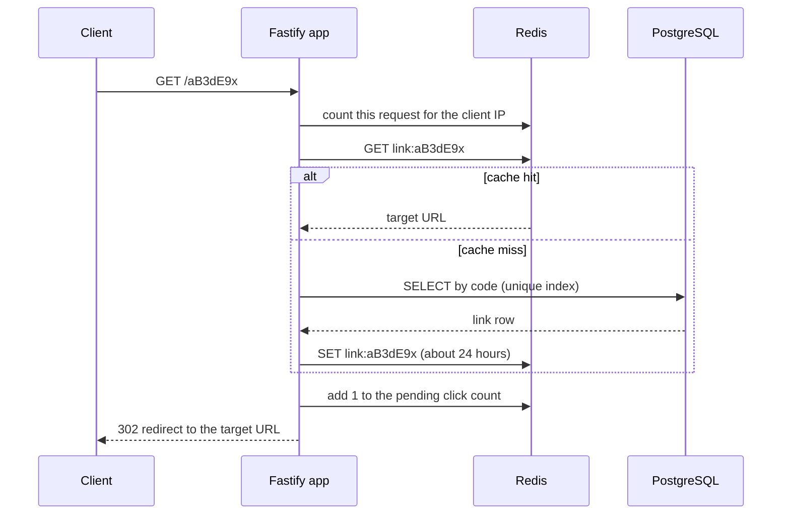
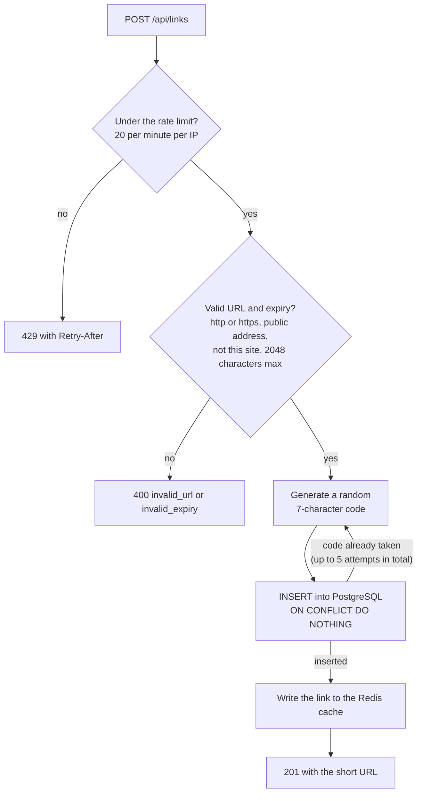
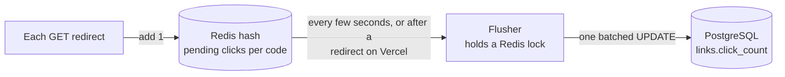

# URL Shortener

A URL shortener built to scale horizontally: Fastify API, PostgreSQL as the source of truth, Redis for caching. It has an API to create, follow and inspect links, `/healthz` and `/readyz`, Redis caching, click counting, rate limiting and Prometheus metrics. See [docs/PLAN.md](docs/PLAN.md) for the architecture and build steps.

Live demo: https://veryshrt.vercel.app


The clip shows the landing page served at `/`, which uses the `POST /api/links` endpoint described under [API](#api).

## Built with

| Area                 | Tools                                                                 |
| -------------------- | --------------------------------------------------------------------- |
| Language and runtime | TypeScript on Node.js 22                                              |
| Web framework        | Fastify 5                                                             |
| Database             | PostgreSQL through node-postgres, with plain SQL migrations           |
| Cache and counters   | Redis through ioredis                                                 |
| Rate limiting        | `@fastify/rate-limit` with a custom Redis store                       |
| Metrics              | `prom-client`, in Prometheus format                                   |
| Front end            | Plain HTML, CSS and JavaScript, with no framework or build step       |
| Testing              | Vitest for unit and integration tests, k6 for load tests              |
| Code quality         | ESLint and Prettier                                                   |
| Containers and edge  | Docker Compose, nginx and PgBouncer                                   |
| Hosting              | Vercel for the function and CDN, Neon for Postgres, Upstash for Redis |
| CI                   | GitHub Actions and Dependabot                                         |

## System design

A URL shortener serves far more redirects than it creates links, so a redirect does as little as it can: it checks Redis, falls back to Postgres on a cache miss, and returns. The same Fastify app runs in two deployments. The live demo runs on Vercel, with Neon for Postgres and Upstash for Redis. The Docker Compose deployment adds nginx and PgBouncer and can run several API replicas.


A short link redirects like this. A cache hit never touches Postgres; a miss reads one row by its unique code and then fills the cache. Every GET redirect also adds one to a pending click count in Redis.



A new link gets a random 7-character code, so replicas have no counter to coordinate. If the insert finds the code already taken, the app picks another.



Clicks collect in Redis and a flusher moves them to Postgres in batches, which keeps a database write off the redirect path. A Redis lock stops two replicas flushing at once.



## Quickstart

With Docker (nginx, API, PgBouncer, Postgres and Redis; only nginx is published, on port 3000):

```sh
cp .env.example .env
docker compose up --build            # one API replica
docker compose up --build --scale api=3
curl localhost:3000/healthz
```

Postgres and Redis are not published to the host. To reach them (tests, `psql`), copy `docker-compose.override.example.yml` to `docker-compose.override.yml`. Scaling, PgBouncer and nginx are described in [docs/SCALING.md](docs/SCALING.md).

Without Docker for the API (needs Node 22):

```sh
npm install
npm run dev
```

## API

Create a link. `expiresAt` is optional and must be a future ISO date. Only `http` and `https` URLs up to 2048 characters are accepted, without credentials, not pointing at `BASE_URL`'s own host, and not pointing at private or loopback addresses (`localhost`, `127.0.0.0/8`, `10.0.0.0/8`, `172.16.0.0/12`, `192.168.0.0/16`, `169.254.0.0/16`, `100.64.0.0/10`, `0.0.0.0/8` and their IPv6 and IPv4-mapped forms). Set `ALLOW_PRIVATE_TARGETS=true` to allow those targets in local development only; the own-host check still applies. Returns `201` with `code`, `shortUrl`, `url` and `expiresAt`.

```sh
curl -X POST localhost:3000/api/links \
  -H 'content-type: application/json' \
  -d '{"url":"https://example.com/page","expiresAt":"2030-01-01T00:00:00Z"}'
```

Follow a short link. Returns `302` to the target, `404` for an unknown code and `410` once the link has expired.

```sh
curl -i localhost:3000/aB3dE9x
```

Read link metadata (`code`, `shortUrl`, `url`, `createdAt`, `expiresAt`, `clickCount`). It still works for expired links.

```sh
curl localhost:3000/api/links/aB3dE9x
```

Errors have the form `{ "error": { "code", "message" } }`, with codes `invalid_url`, `invalid_expiry`, `not_found`, `expired` and `internal_error`.

## Caching

Redirects are cache-aside in Redis under the key `link:{code}`. The value is a small JSON blob with the target URL and expiry. A link is cached for 24 hours (plus or minus 10% jitter), never past its `expiresAt`, and expired links are not cached. Creating a link writes it to the cache. Unknown codes get a negative marker for 60 seconds, so repeated lookups don't reach Postgres; creating a link with that code replaces the marker. Metadata (`GET /api/links/:code`) always reads Postgres.

If `REDIS_URL` is unset or Redis is down, cache errors are swallowed and redirects fall back to Postgres. Redis calls time out after about 200 ms.

`GET /readyz` returns `200` with `{ status, checks: { postgres, redis } }`. Postgres must be `ok`, otherwise it returns `503`. Redis is `ok`, `down` (still `200`) or `disabled`. `GET /healthz` stays a plain liveness check.

## Click counting

Each successful redirect (302) adds one to a Redis hash (`clicks`, field per code). Every `CLICK_FLUSH_INTERVAL_SECONDS` (default 5, `0` turns the timer off) the server moves that hash to `clicks:processing` and adds the totals to `links.click_count` in one SQL statement. A short Redis lock (`clicks:lock`) keeps replicas from flushing at the same time. On shutdown the server does a final flush.

`clickCount` is eventually consistent. On Vercel it can be much further behind; see [docs/DEPLOY_VERCEL.md](docs/DEPLOY_VERCEL.md#click-count-freshness). Clicks that happen while Redis is down are not counted. Counting is at-least-once: a crash or failure between the database write and the cleanup of the in-flight hash (`clicks:processing`) can count one batch twice, while failures before the write lose nothing (the batch is retried). A crash can also lose up to one interval of unflushed clicks. That is fine for analytics. Codes are flushed in sorted order in chunks of 5,000, so concurrent flushers lock rows in the same order. If you set the interval to `0`, run a scheduled job that creates a click counter and calls `flush()`.

## Rate limiting

Limits are per client IP, in fixed windows of `RATE_LIMIT_WINDOW_SECONDS` (default 60). Each route has its own bucket:

| Route                  | Variable                  | Default |
| ---------------------- | ------------------------- | ------- |
| `POST /api/links`      | `RATE_LIMIT_CREATE_MAX`   | 20      |
| `GET /:code`           | `RATE_LIMIT_REDIRECT_MAX` | 600     |
| `GET /api/links/:code` | `RATE_LIMIT_READ_MAX`     | 120     |

`/healthz` and `/readyz` are never limited. Set `RATE_LIMIT_ENABLED=false` to turn limiting off. Over the limit, the API returns `429` with `{ "error": { "code": "rate_limited", ... } }` and a `Retry-After` header; successful responses carry `X-RateLimit-*` headers.

IPv6 clients are bucketed per /64, and IPv4-mapped addresses share a bucket with the plain IPv4. Unmatched routes (404s) share the read limit, so scanning for random paths is throttled too.

Counters live in Redis under `rl:{route}:{ip}`, so all replicas share them. If Redis is unset or down, each instance counts in memory instead (capped at 10,000 clients). That is stricter than failing open, but limits then apply per instance, and the counters restart from zero after an outage, so a client can briefly get up to about 2x the limit once.

Warning: behind a proxy or load balancer, set `TRUST_PROXY` so the real client IP is used; otherwise every client shares the proxy's IP. Leave it unset when clients connect directly. `TRUST_PROXY=true` is only safe when the proxy or platform overwrites `X-Forwarded-For`; otherwise clients pick their own IP and dodge the limits, so use a hop count such as `1` or a comma-separated list of proxy IPs/CIDRs. An invalid forwarded address is ignored and the socket address is used. `/healthz` and `/readyz` are unlimited, so `/readyz` should not be public (the nginx config in `deploy/` hides `/metrics` and `/readyz` from non-private clients). A hop count such as `TRUST_PROXY=1` trusts the connecting peer unconditionally, so the app must only be reachable through that proxy. See [docs/SCALING.md](docs/SCALING.md).

## Metrics

`GET /metrics` serves Prometheus text. It is never rate limited, and `METRICS_ENABLED=false` turns it into a 404.

**`/metrics` is unauthenticated unless `METRICS_TOKEN` is set.** Keep it internal at the proxy, or set a token of at least 16 characters and scrape with `Authorization: Bearer <token>`.

Series (plus the default Node process metrics):

- `http_request_duration_seconds{method,route,status_code}`: histogram. `route` is the route pattern (`/:code`), or `unmatched` for unknown paths.
- `redirect_cache_total{result}`: `hit`, `miss` (Postgres lookup) or `negative`.
- `rate_limit_rejected_total{route}`: 429 responses.
- `clicks_recorded_total`, `click_flush_total{result}` (`ok`, `skipped`, `error`), `click_flush_duration_seconds`.
- `pg_pool_connections{state}` (`total`, `idle`, `waiting`) and `redis_ready` (1 or 0), read at scrape time.

Cache hit ratio:

```promql
sum(rate(redirect_cache_total{result="hit"}[5m])) / sum(rate(redirect_cache_total[5m]))
```

`HEAD /:code` returns the same redirect as `GET` but is not counted as a click. Every response carries `X-Content-Type-Options: nosniff`. Every response carries an `x-request-id` header. A valid incoming one (`A-Z a-z 0-9 . _ -`, up to 64 characters) is reused; otherwise a UUID is generated. The same value is `reqId` in the log lines. Request lines log the method, the path without the query string, the status and the request id; headers and query strings are never logged. Each request writes log lines, so set `LOG_LEVEL=warn` during load tests.

## Scaling out

nginx, PgBouncer and several API replicas: [docs/SCALING.md](docs/SCALING.md). `loadtest/scaleout.sh` runs the whole stack locally without Docker and checks it.

## Deploying to Vercel

Serverless deployment with Neon and Upstash: [docs/DEPLOY_VERCEL.md](docs/DEPLOY_VERCEL.md).

## Load testing

k6 scenarios, a seed script and results are in [docs/LOADTEST.md](docs/LOADTEST.md). Run `npm run loadtest:seed` then `npm run loadtest`.

## CI

`.github/workflows/ci.yml` runs on pushes to `main` and on pull requests, with three jobs:

- `test`: lint, typecheck and Vitest against Postgres and Redis service containers.
- `smoke` (after `test`): builds, migrates, starts the compiled server and runs `loadtest/smoke.js` with k6. The script's thresholds fail the job.
- `config`: `docker compose config` for the base and override files, `nginx -t` on `deploy/nginx.conf`, shell syntax checks, `vercel.json` parsing and `npm audit --omit=dev --audit-level=high`.

Dependabot opens weekly grouped updates for npm and GitHub Actions.

## Scripts

- `npm run dev`: start with file watching (tsx)
- `npm run build`: compile to `dist/`
- `npm start`: run the compiled server
- `npm test`: run Vitest. It needs a `urlshortener_test` database (`TEST_DATABASE_URL`); create it once with `docker compose exec postgres createdb -U urlshortener urlshortener_test` (and use the override file so the host can reach Postgres).
- `npm run lint`: ESLint
- `npm run typecheck`: `tsc --noEmit`
- `npm run format`: Prettier

## Configuration

Environment variables are listed in `.env.example`. `PORT`, `HOST`, `LOG_LEVEL` and `BASE_URL` have defaults. `DATABASE_URL` is required to start the server; `MIGRATE_DATABASE_URL` (default `DATABASE_URL`) is used by `npm run db:migrate` and must be a direct Postgres connection when `DATABASE_URL` goes through PgBouncer; `REDIS_URL` is optional (without it, caching is off). Tests use db 15 of `TEST_REDIS_URL` (default `redis://localhost:6379/15`). Invalid values stop the server at startup.
