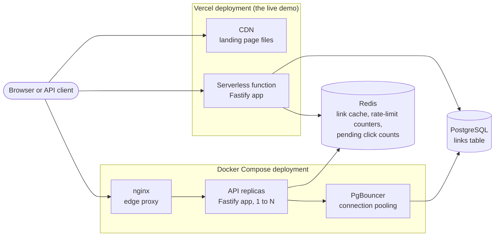
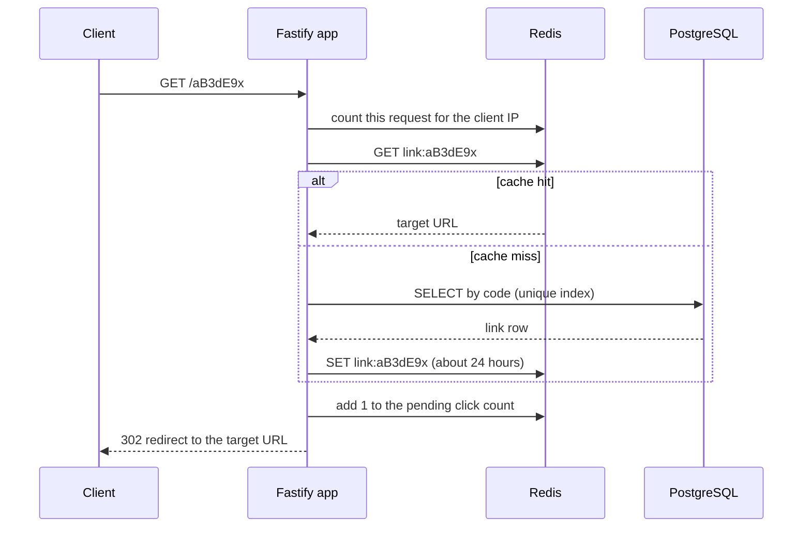
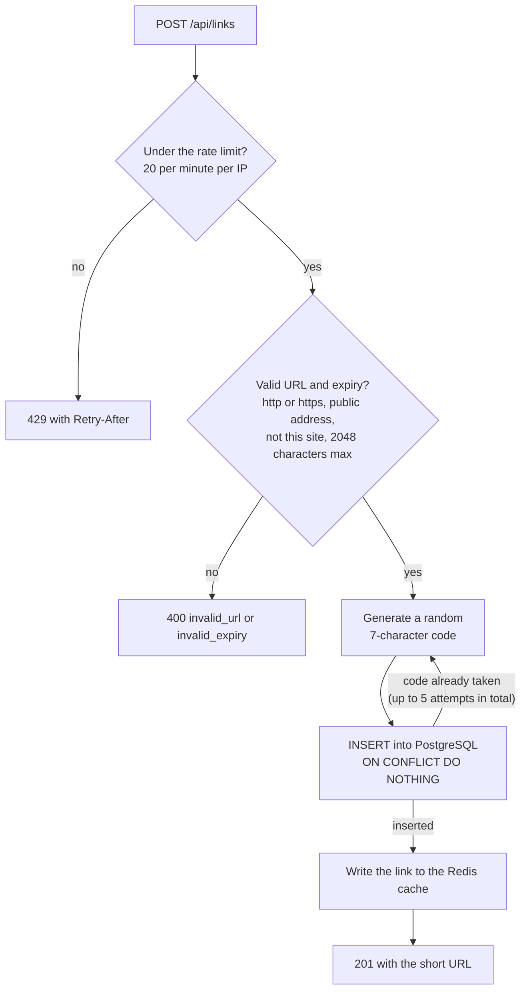
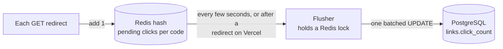

# URL Shortener

A URL shortener built to scale horizontally: Fastify API, PostgreSQL as the source of truth, Redis for caching. It has an API to create, follow and inspect links, `/healthz` and `/readyz`, Redis caching, click counting, rate limiting and Prometheus metrics. See [docs/PLAN.md](docs/PLAN.md) for the architecture and build steps.

Live demo: https://veryshrt.vercel.app

The clip shows the landing page served at `/`, which creates links through `POST /api/links`.

## Built with

| Area                 | Tools                                                                 |
| -------------------- | --------------------------------------------------------------------- |
| Language and runtime | TypeScript on Node.js 22                                              |
| Web framework        | Fastify 5                                                             |
| Database             | PostgreSQL through node-postgres, with plain SQL migrations           |
| Cache and counters   | Redis through ioredis                                                 |
| Rate limiting        | `@fastify/rate-limit` with a custom Redis store                       |
| Metrics              | `prom-client`, in Prometheus format                                   |
| Front end            | Plain HTML, CSS and JavaScript, with no framework or build step       |
| Testing              | Vitest for unit and integration tests, k6 for load tests              |
| Code quality         | ESLint and Prettier                                                   |
| Containers and edge  | Docker Compose, nginx and PgBouncer                                   |
| Hosting              | Vercel for the function and CDN, Neon for Postgres, Upstash for Redis |
| CI                   | GitHub Actions and Dependabot                                         |

## System design

A URL shortener serves far more redirects than it creates links, so a redirect does as little as it can: it checks Redis, falls back to Postgres on a cache miss, and returns. The same Fastify app runs in two deployments. The live demo runs on Vercel, with Neon for Postgres and Upstash for Redis. The Docker Compose deployment adds nginx and PgBouncer and can run several API replicas.

A short link redirects like this. A cache hit never touches Postgres; a miss reads one row by its unique code and then fills the cache. Every GET redirect also adds one to a pending click count in Redis.

A new link gets a random 7-character code, so replicas have no counter to coordinate. If the insert finds the code already taken, the app picks another.

Clicks collect in Redis and a flusher moves them to Postgres in batches, which keeps a database write off the redirect path. A Redis lock stops two replicas flushing at once.

